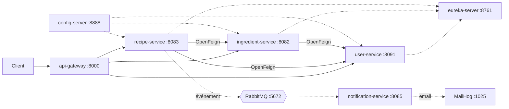
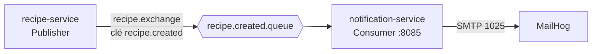

# RecipeAI : backend en microservices

RecipeAI propose des recettes à partir de ce que l'utilisateur possède déjà. Chaque recette reçoit un **score de compatibilité** : le pourcentage de ses ingrédients que l'utilisateur a déjà (1 ingrédient disponible sur 2 donne un score de 50). Le backend est découpé en microservices Spring Boot, chacun avec sa propre base PostgreSQL.

## Sommaire

1. [Architecture](#1-architecture)
2. [Technologies](#2-technologies)
3. [Prérequis](#3-prérequis)
4. [Structure du dépôt](#4-structure-du-dépôt)
5. [Installation et lancement (IntelliJ IDEA)](#5-installation-et-lancement-intellij-idea)
6. [Services, ports et bases de données](#6-services-ports-et-bases-de-données)
7. [API par service](#7-api-par-service)
8. [Communication entre services](#8-communication-entre-services)
9. [Résilience et gestion des erreurs](#9-résilience-et-gestion-des-erreurs)
10. [Messagerie asynchrone (RabbitMQ)](#10-messagerie-asynchrone-rabbitmq)
11. [Tests](#11-tests)
12. [Limites connues](#12-limites-connues)
13. [Équipe et organisation Git](#13-équipe-et-organisation-git)

## 1. Architecture

Le schéma complet est dans [`docs/architecture.md`](docs/architecture.md) et les diagrammes de classes par microservice dans [`docs/class-diagrams.md`](docs/class-diagrams.md). Version simplifiée :



Principes appliqués :

- **Database per Service** : une base PostgreSQL par service métier, sans accès croisé.
- **Références distantes** : `userId` et `ingredientId` sont de simples `Long` sans clé étrangère quand l'objet est dans un autre service. La cohérence est vérifiée par OpenFeign à la création.
- **Architecture en couches** dans chaque service : Entity, Repository, Service (interface et implémentation), Controller. Les entités ne sont jamais exposées : les échanges passent par des DTO validés (Bean Validation) et convertis par MapStruct.
- **Configuration externalisée** : le Config Server fournit port, base de données et adresse d'Eureka à chaque service.
- **Découverte de services** : chaque service s'enregistre dans Eureka, la gateway route avec `lb://NOM-SERVICE` et répartit la charge entre les instances.

## 2. Technologies

Spring Boot 4.1.2, Java 21 (cible), Spring Cloud (Config, Eureka, Gateway, OpenFeign), RabbitMQ 3 (Spring AMQP), Spring Data JPA et Hibernate, PostgreSQL 16, Bean Validation, Lombok, MapStruct 1.6.3, Resilience4j, Docker Compose, Maven wrapper (`mvnw`), Postman et Newman.

## 3. Prérequis

- JDK 21 (un JDK plus récent fonctionne si le projet cible Java 21)
- IntelliJ IDEA (Community ou Ultimate), l'IDE choisi par l'équipe
- Docker Desktop (lancé avant les conteneurs)
- Git
- Postman (pour importer et exécuter les collections de tests)
- Node.js (facultatif, pour exécuter Newman en ligne de commande)
- Une connexion Internet au premier build, pour télécharger les dépendances Maven

Maven n'a pas besoin d'être installé : IntelliJ intègre Maven et chaque service contient le wrapper `mvnw`.

## 4. Structure du dépôt

```text
recipeai-backend/
  config-repo/            fichiers de configuration servis par le Config Server
  config-server/          port 8888
  eureka-server/          port 8761
  api-gateway/            port 8000
  user-service/           port 8091
  ingredient-service/     port 8082
  recipe-service/         port 8083
  notification-service/   port 8085, consomme les événements RabbitMQ (section 10)
  postman/                collections Postman
  docs/                   architecture et diagrammes de classes
  docker-compose.yml      les trois bases PostgreSQL, RabbitMQ et MailHog
  README.md
```

## 5. Installation et lancement (IntelliJ IDEA)

Le projet se lance depuis **IntelliJ IDEA**, sans ligne de commande.

### 5.1 Récupérer et ouvrir le projet

1. Dans IntelliJ : **File > New > Project from Version Control**.
2. URL : `https://github.com/rihabmoslih/recipeai-backend.git`, puis **Clone**.
3. Une fois le projet ouvert, passer sur la branche `develop` : cliquer sur le nom de la branche en bas à droite, puis **develop > Checkout**.

### 5.2 Configurer IntelliJ

1. **JDK** : **File > Project Structure > Project**, choisir un SDK 21 (ou plus récent, avec le niveau de langage 21).
2. **Lombok** : **File > Settings > Build, Execution, Deployment > Compiler > Annotation Processors**, cocher **Enable annotation processing**.
3. **Modules Maven** : chaque service est un projet Maven séparé. Dans l'arborescence, clic droit sur le `pom.xml` de chaque service (`config-server`, `eureka-server`, `api-gateway`, `user-service`, `ingredient-service`, `recipe-service`, `notification-service`), puis **Add as Maven Project**. Chaque service apparaît alors dans la fenêtre **Services** et dans la fenêtre **Maven**.
4. Laisser IntelliJ télécharger les dépendances (barre de progression en bas, connexion Internet nécessaire au premier chargement).

### 5.3 Démarrer l'infrastructure Docker

Lancer **Docker Desktop**, puis au choix :

- **PowerShell** (à la racine du projet) :
  ```powershell
  docker compose up -d
  docker ps --format "table {{.Names}}\t{{.Status}}\t{{.Ports}}"
  ```
- **IntelliJ** : ouvrir `docker-compose.yml` et cliquer sur la flèche verte en face de `services`.

Cinq conteneurs doivent être `Up` : `user-db`, `ingredient-db`, `recipe-db`, `rabbitmq` et `mailhog`. Les tables sont créées automatiquement par Hibernate au premier démarrage des services.

### 5.4 Démarrer les services, dans cet ordre

Pour chaque service : ouvrir sa classe principale (celle annotée `@SpringBootApplication`, par exemple `RecipeServiceApplication`) et cliquer sur la flèche verte **Run**. Attendre la ligne « Started ...Application » dans la console avant de passer au suivant.

| Ordre | Service | Port |
|---|---|---|
| 1 | `config-server` | 8888 |
| 2 | `eureka-server` | 8761 |
| 3 | `user-service` | 8091 |
| 4 | `ingredient-service` | 8082 |
| 5 | `recipe-service` | 8083 |
| 6 | `notification-service` | 8085 |
| 7 | `api-gateway` | 8000 |

Le Config Server et Eureka démarrent en premier : les autres services y lisent leur configuration et s'y enregistrent.

Équivalent **PowerShell** (un terminal par service, à laisser ouvert) :

```powershell
cd C:\Users\PC\recipeai-backend\<nom-du-service>
.\mvnw spring-boot:run
```

### 5.5 Vérifier

Dans un navigateur :

- Eureka : <http://localhost:8761> (tous les services doivent être `UP`)
- Configuration : <http://localhost:8888/user-service/default>
- Gateway : <http://localhost:8000/users> (affiche une liste JSON)

### 5.6 Port déjà utilisé

L'erreur « Port ... was already in use » signifie qu'une ancienne instance tourne encore. Dans IntelliJ, arrêter l'ancienne instance avec le bouton carré rouge **Stop** (fenêtre **Services** ou **Run**), puis relancer. En PowerShell, remplacer `8085` par le port concerné :

```powershell
$p = (Get-NetTCPConnection -LocalPort 8085 -State Listen).OwningProcess | Select-Object -Unique
Stop-Process -Id $p -Force
```

### 5.7 Tester l'équilibrage de charge

1. **Run > Edit Configurations**, sélectionner la configuration de `RecipeServiceApplication`, puis **Copy Configuration**.
2. Nommer la copie `RecipeServiceApplication (8084)` et ajouter dans **Program arguments** : `--server.port=8084`.
3. Lancer les deux configurations. Eureka affiche alors deux instances de `RECIPE-SERVICE`, et la gateway répartit les requêtes entre elles.

## 6. Services, ports et bases de données

| Service | Port | Base de données | Conteneur | Port hôte |
|---|---|---|---|---|
| config-server | 8888 | dossier `config-repo` | - | - |
| eureka-server | 8761 | - | - | - |
| api-gateway | 8000 | - | - | - |
| user-service | 8091 | `user_db` | `user-db` | 5433 |
| ingredient-service | 8082 | `ingredient_db` | `ingredient-db` | 5434 |
| recipe-service | 8083 (et 8084) | `recipe_db` | `recipe-db` | 5435 |
| notification-service | 8085 | - | - | - |
| RabbitMQ | 5672 (AMQP), 15672 (interface) | - | `rabbitmq` | 5672, 15672 |
| MailHog | 1025 (SMTP), 8025 (interface) | - | `mailhog` | 1025, 8025 |

La passerelle écoute sur 8000 car le port 8080 est occupé par un autre outil de développement. Identifiants PostgreSQL de développement : `postgres` / `postgres`.

## 7. API par service

Toutes les requêtes passent par la gateway : `http://localhost:8000`.

### user-service

| Méthode | URL | Description |
|---|---|---|
| POST | `/users` | Créer un utilisateur (201) |
| GET | `/users` | Lister les utilisateurs |
| GET | `/users/{id}` | Consulter un utilisateur |
| PUT | `/users/{id}` | Modifier un utilisateur |
| DELETE | `/users/{id}` | Supprimer (204) |

Règles : nom obligatoire, email valide et unique (409 si déjà utilisé), mot de passe de 8 caractères minimum, rôle `USER` attribué par le service, mot de passe jamais renvoyé.

### ingredient-service

| Méthode | URL | Description |
|---|---|---|
| POST, GET | `/ingredients` | Créer, lister les ingrédients |
| GET, PUT, DELETE | `/ingredients/{id}` | Consulter, modifier, supprimer |
| POST | `/pantry` | Ajouter un élément au garde-manger |
| GET | `/pantry/user/{userId}` | Garde-manger d'un utilisateur |
| GET, PUT, DELETE | `/pantry/{id}` | Consulter, modifier, supprimer |

Règles : nom d'ingrédient unique (409), suppression refusée si l'ingrédient est utilisé dans un garde-manger (409), quantité positive, `userId` vérifié auprès de user-service (404 sinon).

### recipe-service

| Méthode | URL | Description |
|---|---|---|
| POST, GET | `/recipes` | Créer, lister les recettes |
| GET | `/recipes/user/{userId}` | Recettes d'un utilisateur, triées par score décroissant |
| GET, PUT, DELETE | `/recipes/{id}` | Consulter, modifier, supprimer |
| GET | `/recipes/{id}/details` | Vue agrégée : recette, utilisateur et ingrédients enrichis |
| POST | `/favorites` | Ajouter une recette aux favoris |
| GET | `/favorites/user/{userId}` | Favoris d'un utilisateur |
| DELETE | `/favorites/{id}` | Retirer un favori |

Règles : score recalculé à la création et à la modification, au moins un ingrédient obligatoire, `userId` et `ingredientId` vérifiés par OpenFeign (404 sinon), favori en double refusé (409), suppression d'une recette avec suppression de ses favoris.

## 8. Communication entre services

La communication synchrone utilise **OpenFeign**, qui appelle les services par leur nom Eureka, sans URL en dur :

- `recipe-service` : `UserClient` (`USER-SERVICE`) et `IngredientClient` (`INGREDIENT-SERVICE`), utilisés par `RemoteReferenceValidator`.
- `ingredient-service` : `UserClient` (`USER-SERVICE`), utilisé par `RemoteUserValidator`.

L'endpoint `GET /recipes/{id}/details` lit la recette en local, puis interroge user-service et ingredient-service pour renvoyer un `RecipeDetailsDTO` composé.

## 9. Résilience et gestion des erreurs

Dans `recipe-service`, les appels Feign sont protégés par **Resilience4j** :

- **Circuit Breaker** par client : ouverture à 50 % d'échecs après au moins 3 appels, attente de 10 secondes avant de retester.
- **Retry** : 3 tentatives espacées de 300 ms (pas de nouvelle tentative sur un 404).
- **Repli** : réponse 503 claire quand le service appelé est indisponible.
- **Timeout** : 2 secondes en connexion, 3 secondes en lecture (`FeignTimeoutConfig`).

Chaque service possède un `GlobalExceptionHandler` (`@RestControllerAdvice`) qui renvoie un format d'erreur commun :

```json
{
  "timestamp": "2026-11-22T02:00:00",
  "status": 404,
  "error": "Not Found",
  "message": "Recette introuvable",
  "path": "/recipes/999999",
  "details": []
}
```

Pour les erreurs de validation (400), `details` liste les champs en erreur.

## 10. Messagerie asynchrone (RabbitMQ)

La messagerie asynchrone a été réalisée par **Meriem Elmabaddy**. RabbitMQ est le broker : `recipe-service` publie un message sans attendre de réponse, et `notification-service` le traite plus tard. La création d'une recette ne dépend donc ni du temps d'envoi d'un e-mail, ni de la disponibilité du service de notification.



| Élément | Valeur |
|---|---|
| Exchange (direct) | `recipe.exchange` |
| File durable | `recipe.created.queue` |
| Clé de routage | `recipe.created` |
| Format du message | `email\|nom\|titre` |
| Interface RabbitMQ | <http://localhost:15672> (`guest` / `guest`) |
| Boîte de réception MailHog | <http://localhost:8025> |

Si RabbitMQ est indisponible, le Publisher écrit un avertissement dans les logs et la recette est quand même créée.

### Démonstration

1. `docker compose up -d`, puis démarrer `notification-service` et `recipe-service`.
2. Créer une recette (`POST http://localhost:8000/recipes`, par exemple avec la collection Postman).
3. Vérifier : la file dans l'interface RabbitMQ, la ligne de réception dans la console de `notification-service`, puis l'e-mail dans MailHog.

Contrôle rapide en PowerShell (nombre d'e-mails reçus par MailHog) :

```powershell
(Invoke-RestMethod http://localhost:8025/api/v2/messages).total
```

## 11. Tests

Le dossier `postman/` contient deux collections :

- `RecipeAI.postman_collection.json` : CRUD des trois services (38 requêtes).
- `RecipeAI-feign.postman_collection.json` : 44 requêtes avec tests de statut, cas d'erreur (400, 404, 409), validation OpenFeign, endpoint `/details` et nettoyage des données.

Exécution avec l'application Postman (importer le fichier, puis **Run collection**), ou en ligne de commande avec Newman, depuis le terminal intégré d'IntelliJ :

```text
npx --yes newman run postman\RecipeAI-feign.postman_collection.json
```

Résultat obtenu : **44 requêtes, 0 échec**. La variable `baseUrl` vaut `http://localhost:8000` (gateway) et peut être remplacée :

```text
npx --yes newman run postman\RecipeAI-feign.postman_collection.json --env-var "baseUrl=http://localhost:8083"
```

## 12. Limites connues

- Le mot de passe est stocké en clair : un chiffrement BCrypt avec authentification JWT est prévu en phase finale.
- Le champ `disponible` d'un ingrédient de recette est renseigné à la main dans la requête : un calcul automatique à partir du garde-manger est une évolution prévue.
- L'idempotence des créations (en-tête `Idempotency-Key`) est prévue.
- Les identifiants des bases sont ceux d'un environnement de développement.
- L'appel au Publisher dans `RecipeServiceImpl.create` (après la sauvegarde) est à vérifier : sans lui, aucun message n'est publié.
- Hors périmètre de cette livraison : `ai-service`, authentification JWT et front React.

## 13. Équipe et organisation Git

| Membre | Rôle |
|---|---|
| Rihab Moslih (binôme A) | Collection Postman, Service Discovery (Eureka), Config Server, Gateway, OpenFeign et endpoint d'agrégation, résilience (Resilience4j) |
| Meriem Elmabaddy (binôme B) | Messagerie asynchrone : RabbitMQ, Publisher dans `recipe-service`, `notification-service` (Consumer) et envoi des emails |

Branches : `main` (stable), `develop` (intégration), `feature/v2-v3-v4`, `feature/v6-resilience`, `feature/v5-notification`, `feature/v0-docs`. Chaque jalon de la grille est développé dans sa branche puis fusionné dans `develop`.
