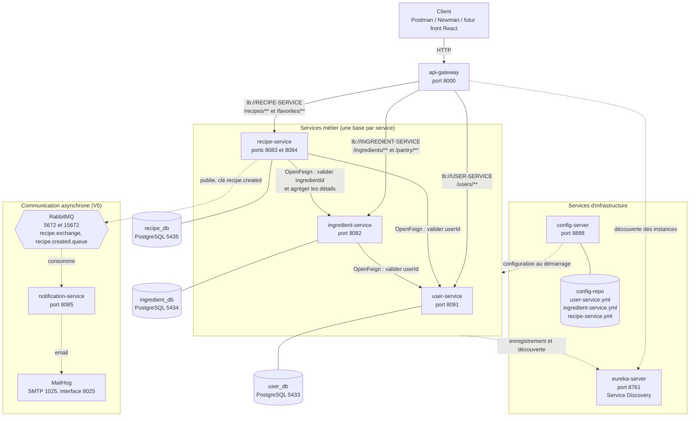

# Schéma d'architecture globale

## Lecture du schéma

- **Traits pleins** : appels synchrones (HTTP via la gateway, OpenFeign entre services, accès aux bases).
- **Traits pointillés** : infrastructure (Eureka, Config Server) et messagerie asynchrone.
- **Références distantes** : `userId` et `ingredientId` sont stockés comme de simples `Long`, sans clé étrangère, car l'objet référencé est dans la base d'un autre service. La cohérence est assurée par les appels OpenFeign.
- **Load balancing** : la gateway résout `lb://NOM-SERVICE` via Eureka et répartit les requêtes entre les instances (exemple : recipe-service sur 8083 et 8084).
