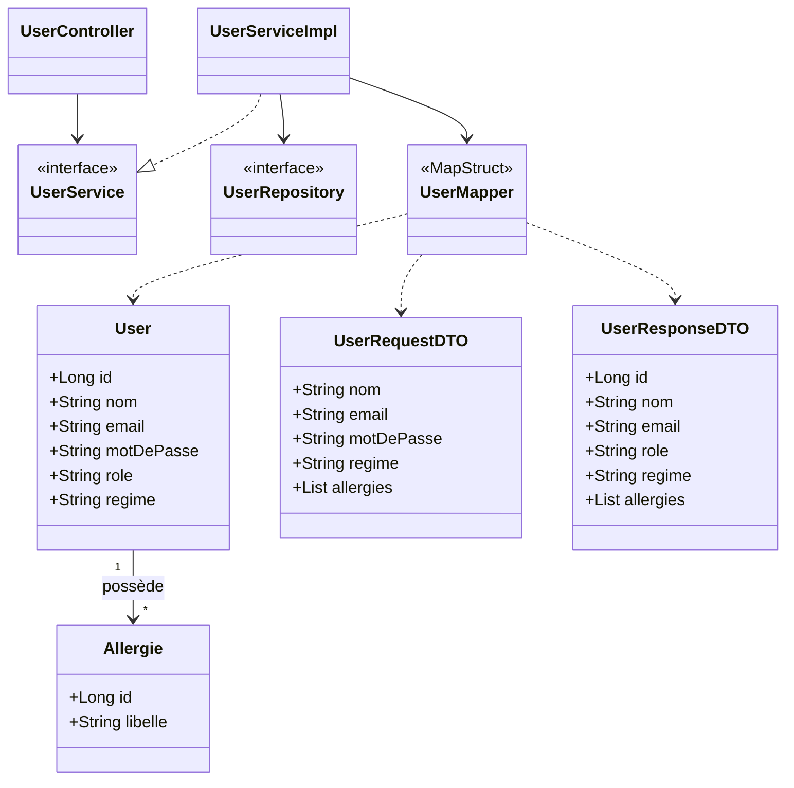
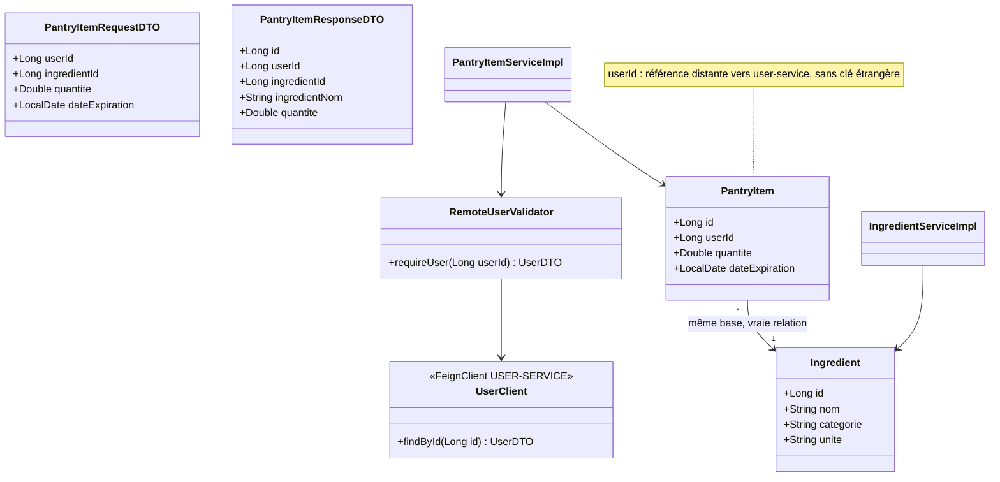
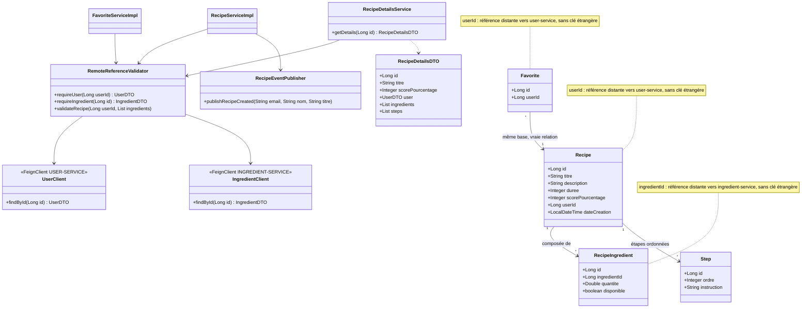
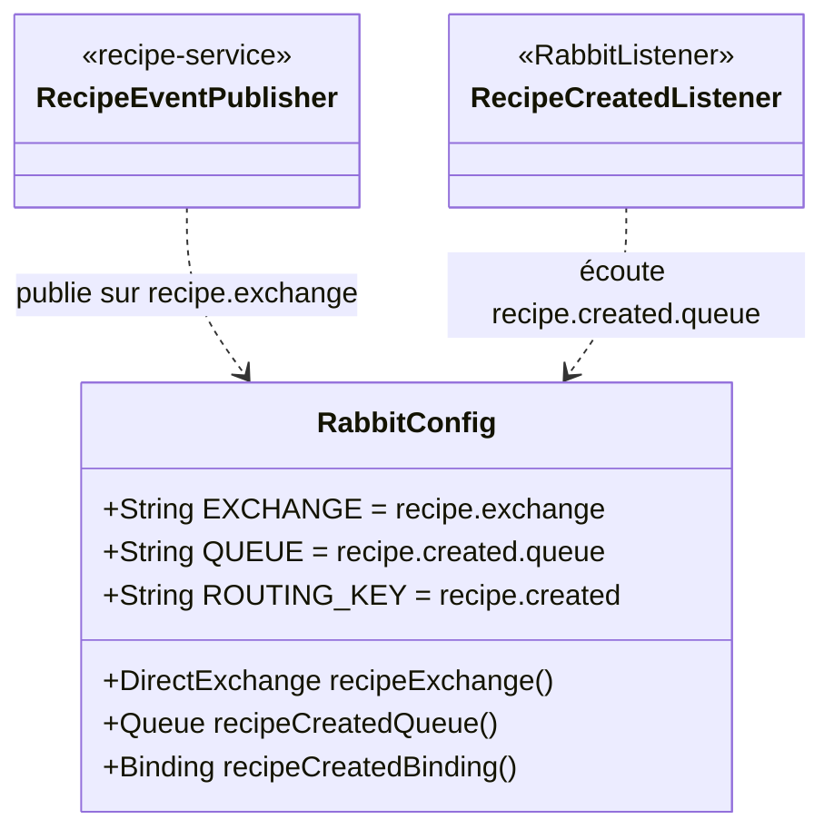

# Diagrammes de classes par microservice

Dans chaque diagramme, les champs `userId` et `ingredientId` sont des **références distantes** : de simples `Long`, sans clé étrangère ni relation JPA, car l'objet est dans la base d'un autre service.

## user-service

## ingredient-service

## recipe-service

## notification-service

Le message est une chaîne `email|nom|titre`. `notification-service` n'a pas de base de données.
